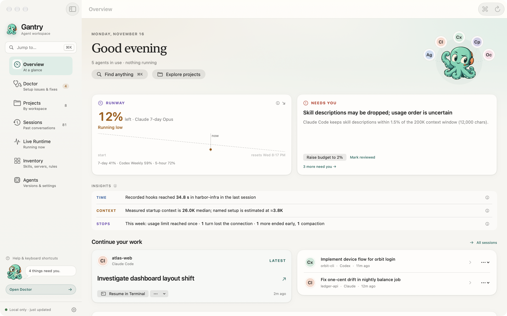
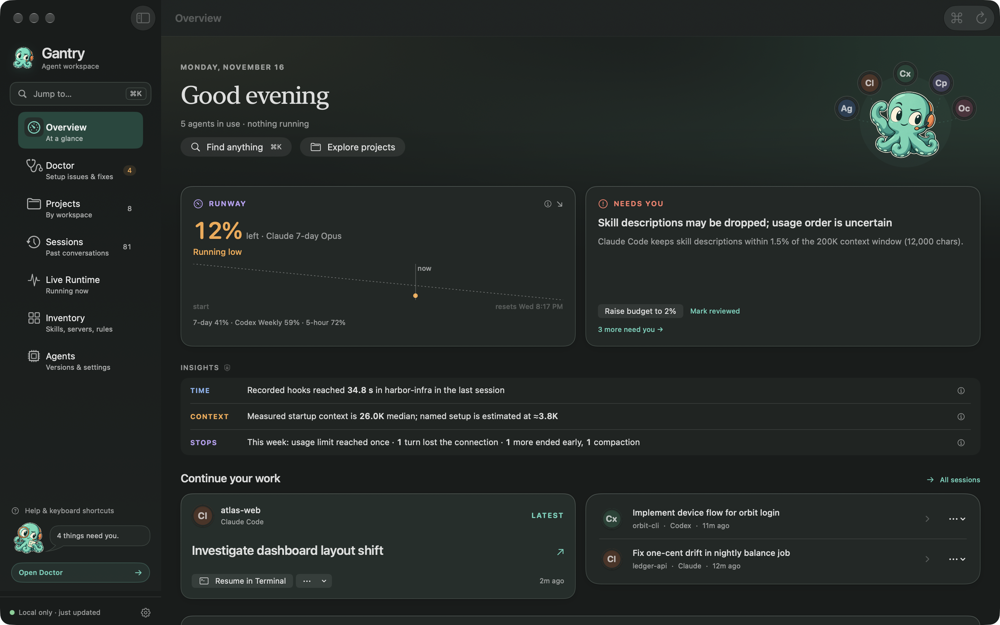
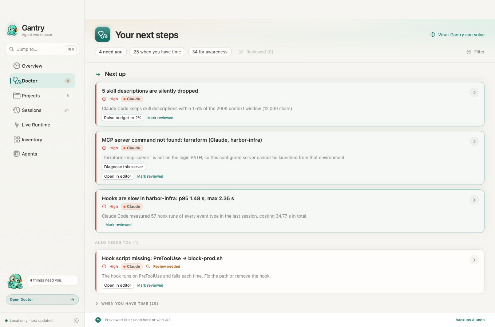

  
  <h1>Gantry</h1>
  
<strong>Switch agents. Keep the thread.</strong>

  
Your local AI coding workspace for <strong>Claude Code, Codex, Cursor, and more</strong>. Find the conversation, review what changed, and continue in Claude Code or Codex with a prompt you control.

  

    
  

  
<strong>Native macOS · Apple silicon &amp; Intel · macOS 14.5+ Completely free, including for commercial use · No Gantry account · No analytics telemetry</strong>

  
Ad-hoc signed; <strong>not notarized by Apple</strong>. <a href="docs/getting-started.md">First-launch instructions</a>.

  
<strong>English</strong> · <a href="README.zh-CN.md">简体中文</a>

  

    <a href="#new-in-210-switch-agents-keep-the-thread">What's new</a> ·
    <a href="#why-gantry">Why Gantry</a> ·
    <a href="docs/workflows.md">Try a workflow</a> ·
    <a href="docs/compatibility.md">Supported tools</a> ·
    <a href="https://github.com/devin-lai/Gantry/issues/new/choose">Feedback</a>
  

## New in 2.1.0: switch agents, keep the thread

Claude Code finished a task. You want Codex to review it. Gantry helps you find that session, see how it ended, and open a new terminal session in the same project with an editable prompt that asks the next agent to pick up the saved work note.

- **Continue across Claude Code and Codex.** Eligible recent sessions offer **Continue in Codex** or **Continue in Claude Code**. Preview the prompt, edit it, then copy it or open it in Terminal. Requires enabled work notes, a saved note, a connected receiving agent, and the target CLI.
- **Find your next action sooner.** A featured recent conversation, readable follow-ups, and a clearer project header put returning to work at the center of the native workspace.
- **Keep useful project knowledge close.** The opt-in **Project Memory** pilot keeps selected decisions available for recall. Review exactly which notes can appear at session startup; manage connections and sources from **Memory options**.
- **Spend less time chasing setup issues.** MCP checks now answer server pings correctly. Refresh follows moved configuration symlinks, session memory views update as records change, and cancelled skill reviews stop their remaining work.

[**Download 2.1.0**](https://github.com/devin-lai/Gantry/releases/download/v2.1.0/Gantry-2.0.0.dmg) · [What's changed](docs/releases/2.1.0.md) · [Try continuation](docs/getting-started.md#continue-in-another-agent)

*Synthetic demo data. Coverage varies by tool; Project Memory and work notes are optional.*

  
<strong>See the workspace in dark appearance</strong>

## Why Gantry

Your coding tools already keep useful evidence on your Mac. Gantry brings the scattered conversations, instructions, skills, hooks, and MCP configuration into one place.

| Your question | What Gantry brings into view |
| --- | --- |
| **“Where did I leave off?”** | Searchable conversations, recorded endings, changed files, current Git state, and copyable handoff notes. |
| **“Which decisions should carry forward?”** | Opt-in Project Memory with reviewable startup notes and on-demand recall for Claude Code and Codex. |
| **“How much quota is left?”** | Cached Claude Code and Codex quota windows, reset times, freshness, and pace, including a menu bar view. |
| **“What loads before my first prompt?”** | Instructions, rules, skills, agent definitions, and MCP schemas, with estimates and recorded context where available. |
| **“Why is this MCP server failing?”** | Configuration, executable, working-directory, environment, initialization, and tool-list outcomes from Gantry's checks. |
| **“What should I change?”** | Doctor findings linked to evidence, previews for supported file edits, local backups, and Undo. |

Use Gantry alongside **Claude Code · Codex · Cursor · Antigravity · OpenCode · Copilot CLI**. Start with one tool; keep your existing workflow.

**Coverage varies.** Quota is available for Claude Code and Codex. Cursor supports desktop conversation history, search, and configuration inventory; its usage, cost, and quota are unavailable. A configuration marked available is not proof that an agent loaded it. [See coverage and limits.](docs/compatibility.md)

## Try it with a recent session

1. [Download and install Gantry](docs/getting-started.md). Read the welcome screen and choose your MCP benchmarking preference.
2. Open **Sessions** and select a recent conversation. Type to filter titles and projects; press **Return** to search conversation content.
3. Review the recorded ending and changed files. Where offered, use **Load session details**, **Copy handoff note**, or **Copy resume command**.

For configuration work, start with **Agents** and choose the tool and project you care about. For quota, start with **Overview**.

**⌘K** jumps to an item · **⌘F** finds search in Sessions · **⌘R** refreshes · **⌘Z** undoes a supported file edit.

[Explore six practical workflows →](docs/workflows.md)

  
<strong>See Doctor in action</strong> — inspect the evidence before changing your setup

*Synthetic demo data. Available findings depend on your setup. File removal uses the Trash; stopping a process cannot be undone with file Undo.*

## Local records. Your choice of action.

Gantry keeps its index and edit backups on your Mac. There is no Gantry account, no analytics telemetry, and no upload of session history to a Gantry service. Read-only Git checks show the current state of recorded changed files; they do not commit or modify your repository.

MCP checks are active operations: they can launch configured servers or contact chosen HTTP endpoints. Those servers can use their own credentials and make network requests. You choose whether automatic stdio benchmarking is enabled. Handoff notes go to your clipboard when you copy them; review them before sharing.

Project Memory is stored locally. Connected agents may send memory context they receive to their model providers. [Privacy details](PRIVACY.md)

## Download and first launch

[**Download Gantry 2.1.0 for macOS**](https://github.com/devin-lai/Gantry/releases/download/v2.1.0/Gantry-2.0.0.dmg) · [Release notes and SHA-256](https://github.com/devin-lai/Gantry/releases/tag/v2.1.0)

Requires **macOS 14.5 Sonoma or later**, on Apple silicon or Intel. Open the DMG and drag **Gantry** into **Applications**.

The download keeps the requested filename `Gantry-2.0.0.dmg`; the application inside is **2.1.0 (build 178)**. Verify it against the checksum on the **2.1.0** release page.

This release is **ad-hoc signed and not notarized by Apple**. After checking the checksum and deciding to trust the download, follow the [first-launch instructions](docs/getting-started.md) if macOS blocks it. A checksum identifies the file; it does not authenticate its publisher.

Use **Help → Check for Updates** when you choose, opt into weekly checks in Settings, or select **Watch → Custom → Releases** on this repository. Updates are installed manually.

## Know what the numbers mean

Quota readings are cached and may be stale. Costs are API-rate estimates, not subscription bills. Context components may be estimated or unattributed. Missing or unreadable records limit what Gantry can show. Changed-file lists cover recorded edit tools; they do not capture every shell-command side effect or establish who owns a change.

[Supported tools and limits](docs/compatibility.md) · [FAQ](docs/faq.md)

## Help shape Gantry

[Ask a question](https://github.com/devin-lai/Gantry/discussions/categories/q-a) or
[share an idea](https://github.com/devin-lai/Gantry/discussions/categories/ideas).
The maintainer aims to answer questions and review ideas weekly, on a best-effort
basis; there is no guaranteed response time. Use [Feedback](https://github.com/devin-lai/Gantry/issues/new/choose)
to choose between discussions and issue forms.

[Report a bug](https://github.com/devin-lai/Gantry/issues/new?template=bug_report.yml), [suggest a workflow](https://github.com/devin-lai/Gantry/issues/new?template=feature_request.yml), or improve the documentation and translations. Remove credentials, private paths, and confidential prompts from public reports.

If Gantry helps you get back to work, **star this repository** so others can find it, and [share the official link](docs/share.md) with another coding-agent user.

[Contributing](CONTRIBUTING.md) · [Report a security issue privately](SECURITY.md)

## License

**Completely free, including for commercial use.** Use Gantry for personal projects, at work, or with clients without charge or separate permission. See [LICENSE](LICENSE).

This public repository contains downloads, documentation, and release assets. The Gantry application source remains closed-source.

Gantry is independent and is not affiliated with the makers of the supported coding tools.
