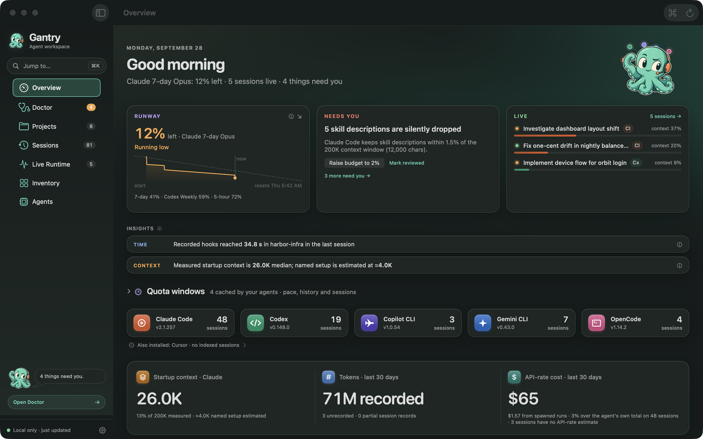
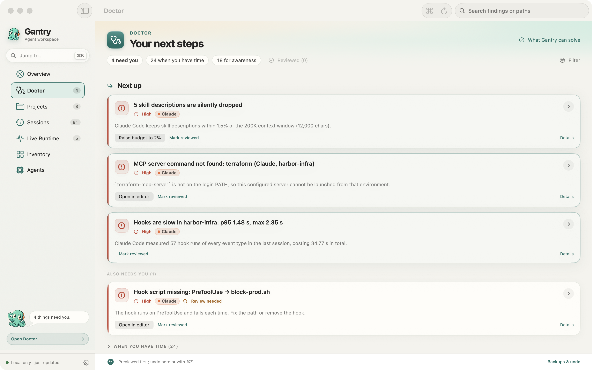

  
  <h1>Gantry</h1>
  
<strong>Know what your AI agents changed. Pick up where they left off.</strong>

  
Your local AI coding workspace for <strong>Claude Code, Codex, Cursor, and more</strong>. Find conversations, review changed files, watch quota, and untangle your setup.

  

    
  

  
<strong>Native macOS · Apple silicon &amp; Intel · macOS 13+ Completely free, including for commercial use · No Gantry account · No analytics telemetry</strong>

  
Ad-hoc signed; <strong>not notarized by Apple</strong>. <a href="docs/getting-started.md">First-launch instructions</a>.

  
<strong>English</strong> · <a href="README.zh-CN.md">简体中文</a>

  

    <a href="#new-in-12-from-conversation-to-continuation">What's new</a> ·
    <a href="#why-gantry">Why Gantry</a> ·
    <a href="docs/workflows.md">Try a workflow</a> ·
    <a href="docs/compatibility.md">Supported tools</a> ·
    <a href="https://github.com/devin-lai/Gantry/issues/new/choose">Feedback</a>
  

*Screenshots use synthetic demo data and may show an earlier interface. Measurements and features vary by tool.*

## New in 1.2: from conversation to continuation

An agent stops. A project is half finished. The next useful step starts with knowing what happened.

- **See what changed.** Review files recorded by agent edit tools, jump to the supporting conversation, and check their current Git status. Find sessions with uncommitted edits.
- **Carry the work forward.** Copy a handoff note with recorded prompts, replies, changed files, commands to review, and a resume command where available. Recent conversations are easier to reach from Overview.
- **Recover older Codex details.** Choose **Load session details** for a selected older or large conversation, with progress, cancellation, and retry.
- **Understand the setup for this project.** Choose a tool and working directory in **Agents** or **Inventory**. Follow skills, plugins, and MCP capabilities to their configuration sources; diagnose an MCP check by the stage that failed.
- **Make a change you can inspect.** Supported Claude Code and Codex settings show scope and affected configuration before writing, then re-read the result. Backups and guarded Undo help you recover.

A quieter light and dark interface, clearer search, and fixes across session parsing, usage estimates, configuration writes, and credential masking round out the release.

[Read the 1.2.0 release notes →](docs/releases/1.2.0.md)

## Why Gantry

Your coding tools already keep useful evidence on your Mac. Gantry brings the scattered conversations, instructions, skills, hooks, and MCP configuration into one place.

| Your question | What Gantry brings into view |
| --- | --- |
| **“Where did I leave off?”** | Searchable conversations, recorded endings, changed files, current Git state, and copyable handoff notes. |
| **“How much quota is left?”** | Cached Claude Code and Codex quota windows, reset times, freshness, and pace, including a menu bar view. |
| **“What loads before my first prompt?”** | Instructions, rules, skills, agent definitions, and MCP schemas, with estimates and recorded context where available. |
| **“Why is this MCP server failing?”** | Configuration, executable, working-directory, environment, initialization, and tool-list outcomes from Gantry's checks. |
| **“What should I change?”** | Doctor findings linked to evidence, previews for supported file edits, local backups, and Undo. |

Use Gantry alongside **Claude Code · Codex · Cursor · Antigravity · OpenCode · Copilot CLI**. Start with one tool; keep your existing workflow.

**Coverage varies.** Quota is available for Claude Code and Codex. Cursor supports desktop conversation history, search, and configuration inventory; its usage, cost, and quota are unavailable. A configuration marked available is not proof that an agent loaded it. [See coverage and limits.](docs/compatibility.md)

## Try it with a recent session

1. [Download and install Gantry](docs/getting-started.md). Read the welcome screen and choose your MCP benchmarking preference.
2. Open **Sessions** and select a recent conversation. Type to filter titles and projects; press **Return** to search conversation content.
3. Review the recorded ending and changed files. Where offered, use **Load session details**, **Copy handoff note**, or **Copy resume command**.

For configuration work, start with **Agents** and choose the tool and project you care about. For quota, start with **Overview**.

**⌘K** jumps to an item · **⌘F** finds search in Sessions · **⌘R** refreshes · **⌘Z** undoes a supported file edit.

[Explore six practical workflows →](docs/workflows.md)

  
<strong>See Doctor in action</strong> — inspect the evidence before changing your setup

*Synthetic demo data. Available findings depend on your setup. File removal uses the Trash; stopping a process cannot be undone with file Undo.*

## Local records. Your choice of action.

Gantry keeps its index and edit backups on your Mac. There is no Gantry account, no analytics telemetry, and no upload of session history to a Gantry service. Read-only Git checks show the current state of recorded changed files; they do not commit or modify your repository.

MCP checks are active operations: they can launch configured servers or contact chosen HTTP endpoints. Those servers can use their own credentials and make network requests. You choose whether automatic stdio benchmarking is enabled. Handoff notes go to your clipboard when you copy them; review them before sharing.

[Privacy details](PRIVACY.md) · [Audit of the 1.2.0 download](docs/1.2.0-audit.md)

## Download and first launch

[**Download Gantry-1.2.0.dmg**](https://github.com/devin-lai/Gantry/releases/download/v1.2.0/Gantry-1.2.0.dmg) · [Release notes and SHA-256](https://github.com/devin-lai/Gantry/releases/tag/v1.2.0)

Requires **macOS 13 Ventura or later**, on Apple silicon or Intel. Open the DMG and drag **Gantry** into **Applications**.

This release is **ad-hoc signed and not notarized by Apple**. After checking the checksum and deciding to trust the download, follow the [first-launch instructions](docs/getting-started.md) if macOS blocks it. A checksum identifies the file; it does not authenticate its publisher.

Use **Watch → Custom → Releases** on this repository for new versions. This build has no built-in update feed.

## Know what the numbers mean

Quota readings are cached and may be stale. Costs are API-rate estimates, not subscription bills. Context components may be estimated or unattributed. Missing or unreadable records limit what Gantry can show. Changed-file lists cover recorded edit tools; they do not capture every shell-command side effect or establish who owns a change.

[Supported tools and limits](docs/compatibility.md) · [FAQ](docs/faq.md)

## Help shape Gantry

[Report a bug](https://github.com/devin-lai/Gantry/issues/new?template=bug_report.yml), [suggest a workflow](https://github.com/devin-lai/Gantry/issues/new?template=feature_request.yml), or improve the documentation and translations. Remove credentials, private paths, and confidential prompts from public reports.

If Gantry helps you get back to work, **star this repository** so others can find it, and [share the official link](docs/share.md) with another coding-agent user.

[Contributing](CONTRIBUTING.md) · [Report a security issue privately](SECURITY.md)

## License

**Completely free, including for commercial use.** Use Gantry for personal projects, at work, or with clients without charge or separate permission. See [LICENSE](LICENSE).

Gantry is independent and is not affiliated with the makers of the supported coding tools.
