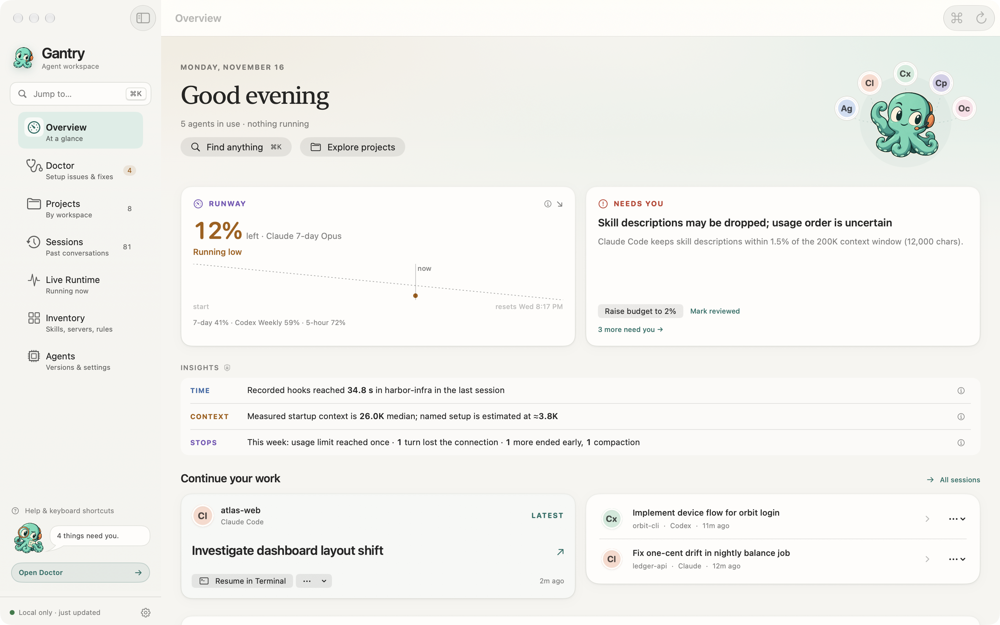

  
  <h1>Gantry</h1>
  
<strong>切换助手，接着做。</strong>

  
面向 <strong>Claude Code、Codex、Cursor 等工具</strong>的本地 AI 编程工作台。 找回对话、查看改动，用自己确认的提示词在 Claude Code 或 Codex 中继续工作。

  
<a href="https://github.com/devin-lai/Gantry/releases/download/v2.1.0/Gantry-2.0.0.dmg"><strong>下载 Gantry 2.1.0</strong></a> · <a href="docs/getting-started.md">安装说明（英文）</a> · <a href="https://github.com/devin-lai/Gantry/releases/tag/v2.1.0">发布说明与校验值</a>

  
<strong>原生 macOS · macOS 14.5+ · Apple 芯片与 Intel 完全免费，包括商业用途 · 无需 Gantry 账户 · 无分析遥测</strong>

  
此版本采用 ad-hoc 签名，<strong>未经 Apple 公证</strong>。

  
<a href="README.md">English</a> · <strong>简体中文</strong>

## 2.1.0 新功能 · 切换助手，接着做

Claude Code 做完实现，想让 Codex 接着审阅？先在 Gantry 找到刚才的会话、查看结束记录，再预览交接提示词，在同一项目中打开新的终端会话。

- **Claude Code 与 Codex 之间续接工作。** 符合条件的近期会话会显示 **Continue in Codex** 或 **Continue in Claude Code**。提示词可编辑、复制，也可确认后在终端打开。需要开启工作笔记、有已保存的笔记、连接接收交接的助手，并安装目标 CLI。
- **更容易找到下一步。** Overview 突出最近的对话，后续工作列表更清晰，Projects 的项目标题和操作也更醒目。
- **把项目经验留给下一次会话。** 自愿开启的 **Project Memory（项目记忆）** 试用功能保留选定决策供助手查询；会话启动内容仍由你预览和批准。通过 **Memory options** 管理连接与来源。
- **减少配置排查中的干扰。** MCP 检查正确响应服务器 ping；配置符号链接变化后继续自动刷新；会话记忆随记录更新；取消技能审阅后停止剩余后台工作。

[**下载 2.1.0**](https://github.com/devin-lai/Gantry/releases/download/v2.1.0/Gantry-2.0.0.dmg) · [完整更新说明（英文）](docs/releases/2.1.0.md) · [跨助手续接入门（英文）](docs/getting-started.md#continue-in-another-agent)

*截图使用合成数据。各工具覆盖范围不同；项目记忆和工作笔记均为可选功能。中文介绍不代表应用界面已支持中文。*

## Gantry 能帮你看清什么

| 你关心的问题 | Gantry 提供的信息 |
| --- | --- |
| **上次做到哪里了？** | 可搜索的对话、记录中的停止原因、文件变化、当前 Git 状态和可复制的交接说明。 |
| **配额还剩多少？** | Claude Code 和 Codex 的本地缓存配额、重置时间、数据新鲜度与菜单栏视图。 |
| **第一条提示词前加载了什么？** | 指令、规则、技能、代理定义和 MCP 工具描述，以及可用的 token 估算与上下文记录。 |
| **MCP 为什么失败？** | Gantry 检查中的配置、可执行文件、工作目录、环境、初始化和工具列表结果。 |
| **应该改哪项配置？** | Doctor 发现与证据、支持的修改预览、本地备份和撤销。 |

支持 **Claude Code、Codex、Cursor、Antigravity、OpenCode 和 Copilot CLI**。只用其中一种也可以，无需迁移工作流。

**各工具覆盖范围不同。** 配额适用于 Claude Code 和 Codex；Cursor 支持桌面对话历史、搜索与配置清单，用量、费用与配额不可用。配置可用或 Gantry 检查成功，不代表代理已经加载或批准该能力。[兼容性与限制（英文）](docs/compatibility.md)

## 从最近的一次会话开始

1. 安装 Gantry，阅读欢迎界面并选择 MCP 基准测试偏好。
2. 打开 **Sessions**，选择最近的对话；输入文字筛选标题与项目，按 **Return** 搜索对话内容。
3. 查看停止记录、文件变化和 Git 状态；按需使用 **Load session details**、**Copy handoff note** 或 **Copy resume command**。

配置问题从 **Agents** 开始，配额从 **Overview** 开始。**⌘K** 快速跳转，**⌘F** 定位 Sessions 搜索，**⌘R** 刷新，**⌘Z** 撤销支持的文件修改。

[六个实用工作流（英文）→](docs/workflows.md)

## 本地记录，由你选择操作

索引与修改备份保存在你的 Mac 上。Gantry 无需账户、不含分析遥测，也不会把会话历史上传到 Gantry 服务。Git 检查只读，不会提交或修改仓库。

MCP 检查可能启动已配置的服务器或访问选定的 HTTP 端点；服务器可以使用自身凭据并发起网络请求。你可以选择是否开启自动 stdio 基准测试。交接说明在点击复制后进入剪贴板，分享前请检查其中的私有内容。

项目记忆保存在本机。已连接的编程助手可能将收到的上下文发送给其模型服务商。[隐私说明（英文）](PRIVACY.md)

## 下载与首次启动

从[官方发布页](https://github.com/devin-lai/Gantry/releases/tag/v2.1.0)下载 `Gantry-2.0.0.dmg` 和 `SHA256SUMS.txt`，核对 SHA-256 后打开 DMG，将 **Gantry** 拖入 **Applications**。

下载文件沿用 `Gantry-2.0.0.dmg` 名称，内部应用版本为 **2.1.0（build 178）**；请使用 **2.1.0** 发布页的校验值核对。

要求 **macOS 14.5 Sonoma 或更新版本**，支持 Apple 芯片和 Intel。此版本采用 ad-hoc 签名，**未经 Apple 公证**。如果 macOS 阻止首次启动，请在核对文件并决定信任下载后，按[安装说明（英文）](docs/getting-started.md)操作。校验值用于确认文件内容，不代表 Apple 认可或发布者身份认证。

可通过 **Help → Check for Updates** 手动检查，或在设置中选择每周检查；更新需要手动安装。也可在仓库中选择 **Watch → Custom → Releases** 接收通知。

## 正确理解数据

配额是本地缓存，可能过时；费用按 API 价格估算，不是订阅账单。上下文可能包含估算或无法归因的部分。文件变化来自支持的编辑工具，不涵盖所有 shell 命令的副作用，也不能确定修改归谁所有。缺失或不可读的记录会限制结果。

[常见问题（英文）](docs/faq.md) · [兼容性（英文）](docs/compatibility.md)

## 帮助更多用户发现 Gantry

欢迎在 Discussions [提问](https://github.com/devin-lai/Gantry/discussions/categories/q-a)或[分享想法](https://github.com/devin-lai/Gantry/discussions/categories/ideas)。维护者争取每周回复问题、查看建议，但不保证响应时间。[反馈入口](https://github.com/devin-lai/Gantry/issues/new/choose)提供讨论区和问题表单。

如果 Gantry 帮你更顺畅地继续工作，欢迎 **Star 仓库**，并[分享官方链接](docs/share.md)。也欢迎[报告问题](https://github.com/devin-lai/Gantry/issues/new?template=bug_report.yml)、[提出工作流建议](https://github.com/devin-lai/Gantry/issues/new?template=feature_request.yml)或改进翻译。

公开提交前，请移除凭据、私有路径和机密提示词。敏感安全问题请按 [SECURITY.md](SECURITY.md) 私下报告。[贡献说明](CONTRIBUTING.md)

## 许可

**完全免费，包括商业用途。** 无论用于个人项目、公司工作还是客户项目，均无需付费或另行获得许可。完整条款以 [LICENSE](LICENSE) 为准。

本公开仓库提供下载、文档和发布素材；Gantry 应用程序的源码仍为闭源。

Gantry 是独立应用，与所支持编程工具的厂商没有隶属关系。
