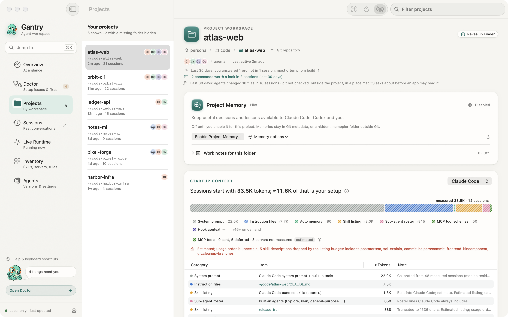

# Get started with Gantry

Requires **macOS 14.5 Sonoma or later**, on Apple silicon or Intel. You do not
need a Gantry account or an API key to inspect local records. At least one
supported coding agent with local records makes the app useful.

## Install

1. Get `Gantry-2.0.0.dmg` and `SHA256SUMS.txt` from the [official 2.1.0 release](https://github.com/devin-lai/Gantry/releases/tag/v2.1.0).
2. Compare the DMG's checksum with the value in the release notes or checksum file:

   ```sh
   shasum -a 256 ~/Downloads/Gantry-2.0.0.dmg
   ```

3. The filename remains `Gantry-2.0.0.dmg`; this release contains **2.1.0 (build 178)**. Open the disk image and drag Gantry into Applications.
4. Eject the disk image and open Gantry from Applications.

Gantry 2.1.0 has an ad-hoc signature and is not notarized
by Apple. A checksum identifies the downloaded bytes; it does not establish
Apple's approval or the publisher's identity. If macOS blocks the app, verify
the download and decide whether you trust it, then use **System Settings →
Privacy & Security → Open Anyway** after the attempted launch. Follow
[Apple's first-launch guidance](https://support.apple.com/en-us/102445).

## Your first minute

- Read the welcome screen and choose whether Gantry may benchmark stdio MCP servers automatically. You can keep it off and benchmark later.
- Allow access to relevant folders if you want Gantry to inspect those projects.
- Start with **Overview** for quota, context, and findings, then **Doctor** for the evidence and next steps.
- Open **Inventory** for skills and MCP servers, **Sessions** for recorded usage, or **Live Runtime** for running processes.
- In **Sessions**, type to filter titles and projects; press **Return** to search conversation contents. Open a result to read the passage and use **Copy resume command** where supported.
- Review **Changed files** and current Git status, or use **Copy handoff note** to prepare for another session. Check copied notes for private content before sharing.
- For older Codex conversations, **Load session details** can recover recorded endings, edits, and commands, with progress and cancellation.
- Open **Agents** and select a tool and working directory to inspect capabilities for that context.
- Use **⌘K** to jump, **⌘R** to refresh, and **⌘Z** to undo the last supported file change.

Missing records or unsupported measurements are expected for some tools. Check
[coverage](compatibility.md) before interpreting an empty view as a problem.
For a concrete place to start, [choose one of six workflows](workflows.md).

## Try Project Memory

Project Memory is an opt-in pilot for Claude Code and Codex.

1. In **Projects**, open **Review projects…** and choose **Turn on…** beside one project. Review the selected folders if you want to import existing Claude Code notes.
2. On that project's **Project Memory** card, open **Memory options → Connect agents…** and **Preview changes** for the agent you want to use. Review the changes and apply them if you want to connect. For Codex startup context, review and trust the optional hook in Codex.
3. Save a useful project decision, then start a new session in that project and ask the connected agent to recall it. Use **Review** in Project Memory to choose which notes can appear automatically at session start.



*Synthetic project data. Project Memory is off until enabled.*

## Continue in another agent

1. Enable Project Memory for a project and connect the Claude Code or Codex agent that will receive the handoff, using **Memory options → Connect agents…**.
2. Expand **Work notes for this folder** and review the opt-in settings. Work notes retain recorded session endings and reports locally, within size limits. Gantry must be running to write them. Review any offered login-launch and notification settings.
3. After an eligible Claude Code or Codex session finishes, find it in **Sessions** or the **Not followed up** list. With the target CLI installed and a saved work note available, choose **Continue in Codex** or **Continue in Claude Code**.
4. Review or edit the prompt, then choose **Copy** or **Open in Terminal**. The new agent retrieves the named note when it calls the pickup tool. Check its interpretation against the current files before continuing.

Work notes start off and can be disabled or excluded by folder. Continuing opens a new session; **Resume in Terminal** reopens a supported existing session. Availability depends on the session's recorded ending, recent activity, folder access, and note settings. [Privacy and local storage](../PRIVACY.md)

## Updates

Gantry 2.1.0 checks for updates when you choose **Help → Check for Updates**,
or weekly if you explicitly opt in. It opens a release download in your browser;
it never downloads or installs updates automatically. You can also watch this
repository's **Releases** notifications. Ad-hoc builds may ask for protected-folder
access again after an update.

Before upgrading, check that your Mac runs macOS 14.5 or later. Quit Gantry,
open the 2.1.0 release DMG, and replace Gantry in Applications. Keep Gantry's Application
Support folder if you want to retain its index and edit backups.
[Read what's new in 2.1.0.](releases/2.1.0.md)

## Report a problem

Use **Help → Diagnostic Report** to generate a local report. Review and redact
it before pasting anything into a [bug report](https://github.com/devin-lai/Gantry/issues/new?template=bug_report.yml).
Never share credentials, full transcripts, private prompts, or unredacted paths.

## Uninstall

Quit Gantry and move the app from Applications to the Trash. If you also remove
`~/Library/Application Support/Gantry`, you remove its index and edit backups;
keep those backups if you may need to restore a change. Its preferences are at
`~/Library/Preferences/github.devin-lai.gantry.plist`. Removing the app does not undo
changes you previously chose to apply to agent configuration.
