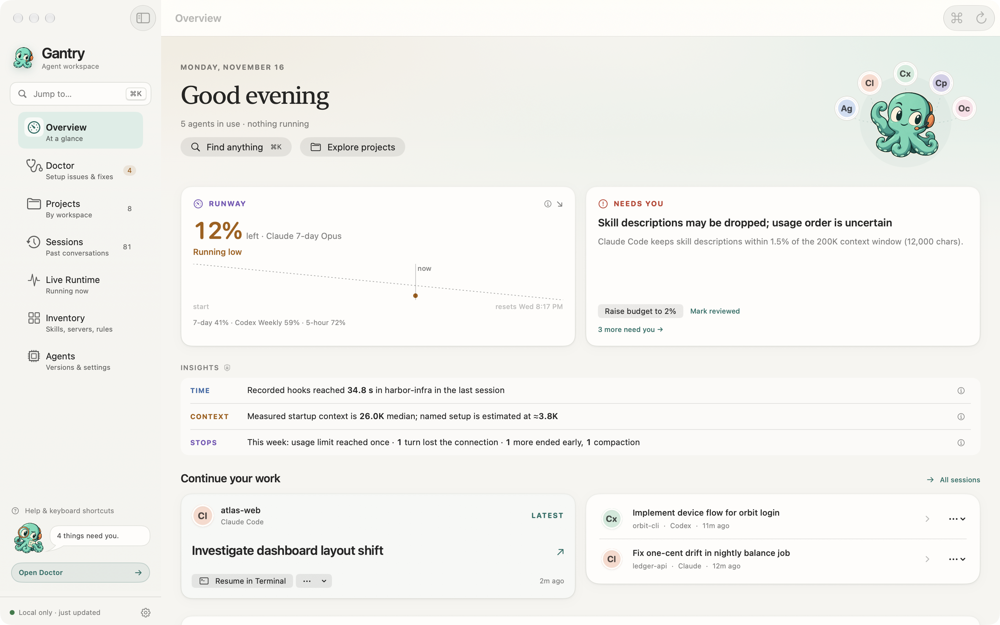

# Gantry 2.1.0 — Switch agents. Keep the thread.

**Find the last conversation. Review what changed. Continue in Claude Code or Codex.**

Gantry brings your AI coding sessions, project decisions, quota, and MCP setup into one native Mac workspace. Version 2.1.0 makes the next step easier to find and adds an editable handoff from a finished session to another agent.

**macOS 14.5+ · Apple silicon & Intel · Free for personal and commercial use**

[**Download for macOS**](https://github.com/devin-lai/Gantry/releases/download/v2.1.0/Gantry-2.0.0.dmg) · [First-launch guide](https://github.com/devin-lai/Gantry/blob/main/docs/getting-started.md) · [简体中文](https://github.com/devin-lai/Gantry/blob/main/README.zh-CN.md)

## From finished work to the next agent

For eligible recent Claude Code and Codex sessions, choose **Continue in Codex** or **Continue in Claude Code**. Gantry opens a preview with an editable prompt naming the saved work note. Copy it, or choose **Open in Terminal** to start a new session in the recorded project folder. You can also start a new session in the same agent.

Continuation needs enabled work notes, an available saved note, and the target CLI. The receiving agent must be connected to Project Memory to retrieve the note. Active, unsupported, or unavailable sessions do not offer this action. These are new sessions; the receiving agent reads the saved note when it calls the pickup tool.

## A clearer place to return to work

- **Featured recent work:** the latest conversation stands out beside compact recent items.
- **Readable follow-ups:** recognize finished work by conversation title and recorded result, with actions close at hand.
- **Refined Projects:** clearer project identity, primary memory actions, and a **Memory options** menu for connections and sources.
- **Visible availability:** work-note and notification status explain when Gantry needs attention. Work-note writing requires Gantry to be running.



## Reliability fixes

- Answer MCP server pings across stdio, Streamable HTTP, and legacy SSE checks, avoiding false timeouts for servers waiting for a response.
- Refresh watched configuration when symlink targets change, including linked skill and followed-note folders.
- Update an open session-memory inspector as queries and corrected outcomes change, while preserving a draft annotation.
- Stop remaining background skill-review work after cancellation; explicit previews still work when the background read budget is exhausted.
- Explain unreadable previews instead of presenting them as empty files, and keep oversized pickup ages from breaking session-index persistence.

## Local records, deliberate handoffs

No Gantry account or analytics telemetry. Project Memory and work notes are opt-in. Startup memories require review; a continuation prompt remains editable. Connected agents may send the context they receive to their model providers. [Privacy details](https://github.com/devin-lai/Gantry/blob/main/PRIVACY.md)

## Download and verify

The asset keeps the requested filename **`Gantry-2.0.0.dmg`**. The application inside is **Gantry 2.1.0 (build 178)**. Use this release's checksum; the older 2.0.0 release has a different file with the same name.

```text
dc1ee682cd54d72faba915e06b26ba3771d53ebed7c661ccd1acda684a6a88ea  Gantry-2.0.0.dmg
```

[Download SHA256SUMS.txt](https://github.com/devin-lai/Gantry/releases/download/v2.1.0/SHA256SUMS.txt)

Open the DMG and drag Gantry into Applications. This release is **ad-hoc signed and not notarized by Apple**. If macOS blocks first launch, verify the download and follow **System Settings → Privacy & Security → Open Anyway**. [Installation and upgrade guide](https://github.com/devin-lai/Gantry/blob/main/docs/getting-started.md)

Validation and artifact inspection: [2.1.0 audit](https://github.com/devin-lai/Gantry/blob/main/docs/2.1.0-audit.md). The public repository contains documentation and downloads; application source remains closed-source.

If Gantry makes switching agents easier, **star the repository** and [share a workflow or report an issue](https://github.com/devin-lai/Gantry/issues/new/choose). Feedback helps shape what comes next.
