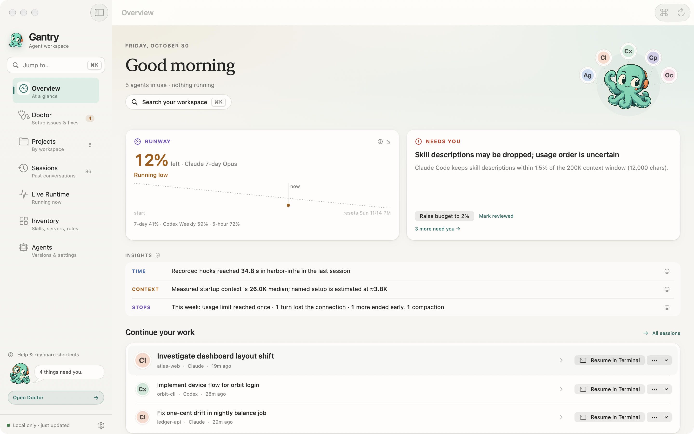

# Share Gantry with another agent user

[Repository](https://github.com/devin-lai/Gantry) · [Gantry 1.3.2](https://github.com/devin-lai/Gantry/releases/tag/v1.3.2) · [简体中文介绍](../README.zh-CN.md)

Share the official repository or release link so readers get the current
documentation, license, first-launch instructions, and checksum together.

## A short description

> Find your place. Get back to building. Gantry brings AI coding sessions,
> quota, and MCP configuration together in one native Mac app. Search your
> work, inspect the setup, and resume supported sessions. Free for personal
> and commercial use. macOS 14.5+.

## A little more context

> Your conversation is in one tool, and your setup is scattered across others.
> Gantry is a local workspace for Claude Code, Codex, Cursor, Antigravity,
> OpenCode, and Copilot CLI. Find a saved conversation, review recorded
> changes, see cached quota where supported, and inspect MCP configuration.
> Version 1.3.2 adds a refreshed Overview, scoped ⌘K search, and supported
> Terminal handoffs. No Gantry account or analytics telemetry. Apple silicon
> and Intel, macOS 14.5+. Ad-hoc signed and not notarized by Apple; follow
> the official first-launch guide.

## 简短介绍

> 找回对话，理清配置，继续构建。Gantry 将 AI 编程会话、配额和 MCP 配置放进
> 一个原生 Mac 工作台。1.3.2 带来全新总览、分类搜索和受支持会话的终端续接。
> 个人与商业用途均免费，要求 macOS 14.5+。当前版本未经 Apple 公证，请先阅读安装说明。

## What to keep clear

- Gantry is an independent companion app; tool coverage varies. Quota coverage is for Claude Code and Codex. Cursor includes desktop history and search, with usage, cost, and quota unavailable.
- Costs are estimates at API rates, and quotas are locally cached readings. Avoid presenting them as billing data or promising savings.
- Changed files come from recorded edit tools; Git checks do not establish who owns a change. Handoff notes contain recorded content, not a newly generated model summary.
- Gantry is completely free, including for commercial use. No separate permission is needed for business, employer, or client use.
- Link to the official download rather than rehosting the DMG. The [license](../LICENSE) does not grant a general reuse license for branding, artwork, or documentation.
- Use synthetic examples when discussing a workflow. Never share private session content, credentials, account identifiers, or unredacted diagnostics.

The 1.3.2 preview [Overview](../assets/overview-1.3.2-light.png), along with
the earlier 1.3.0 [Sessions](../assets/sessions-1.3.0-light.png) and
[Doctor](../assets/doctor-1.3.0-light.png) screenshots, illustrates the interface
with synthetic data. They are not customer records or performance benchmarks.
