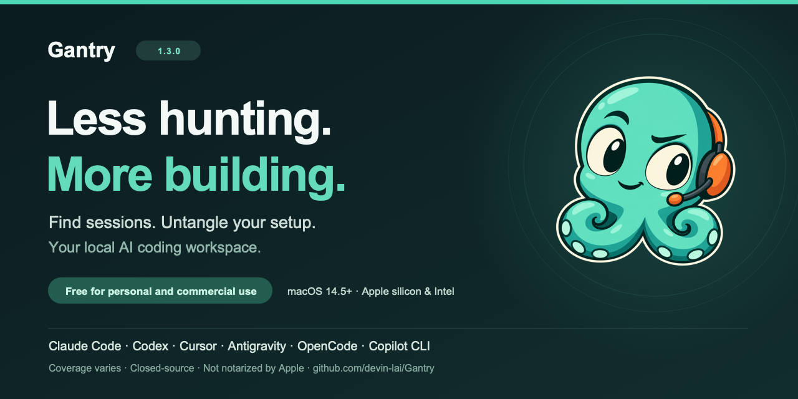

# Share Gantry with another agent user

[Repository](https://github.com/devin-lai/Gantry) · [Gantry 1.3.0](https://github.com/devin-lai/Gantry/releases/tag/v1.3.0) · [简体中文介绍](../README.zh-CN.md)

Share the official repository or release link so readers get the current
documentation, license, first-launch instructions, and checksum together.

## A short description

> Your AI coding work is scattered. Gantry brings it together. Find conversations,
> inspect changed files, watch quota, and untangle MCP configuration in one native
> Mac app. Gantry 1.3 adds clearer projects and a more focused session browser.
> Free for personal and commercial use. macOS 14.5+.

## A little more context

> Less hunting. More building. Gantry is a local workspace alongside Claude Code,
> Codex, Cursor, Antigravity, OpenCode, and Copilot CLI. Search a conversation,
> review its recorded changes, and copy a handoff note or resume command where
> supported. Version 1.3 separates independent chats from real projects and
> improves filters, small-window layouts, and everyday reliability.
> No Gantry account or analytics telemetry. Apple silicon and Intel, macOS 14.5+.
> Ad-hoc signed and not notarized by Apple; follow the official first-launch guide.

## 简短介绍

> 找回对话，理清配置，继续构建。Gantry 1.3 把 AI 编程工具的本地对话、文件变化、
> 配额和 MCP 诊断放到同一个原生 Mac 工作台，带来更清楚的项目组织、更顺手的会话
> 筛选和更可靠的小窗口布局。个人与商业用途均免费，要求 macOS 14.5+。
> 当前版本未经 Apple 公证，请先阅读安装说明。

## What to keep clear

- Gantry is an independent companion app; tool coverage varies. Quota coverage is for Claude Code and Codex. Cursor includes desktop history and search, with usage, cost, and quota unavailable.
- Costs are estimates at API rates, and quotas are locally cached readings. Avoid presenting them as billing data or promising savings.
- Changed files come from recorded edit tools; Git checks do not establish who owns a change. Handoff notes contain recorded content, not a newly generated model summary.
- Gantry is completely free, including for commercial use. No separate permission is needed for business, employer, or client use.
- Link to the official download rather than rehosting the DMG. The [license](../LICENSE) does not grant a general reuse license for branding, artwork, or documentation.
- Use synthetic examples when discussing a workflow. Never share private session content, credentials, account identifiers, or unredacted diagnostics.

The 1.3 [Overview](../assets/overview-1.3.0-dark.png),
[Sessions](../assets/sessions-1.3.0-light.png), and
[Doctor](../assets/doctor-1.3.0-light.png) screenshots illustrate the interface
with synthetic data. They are not customer records or performance benchmarks.
