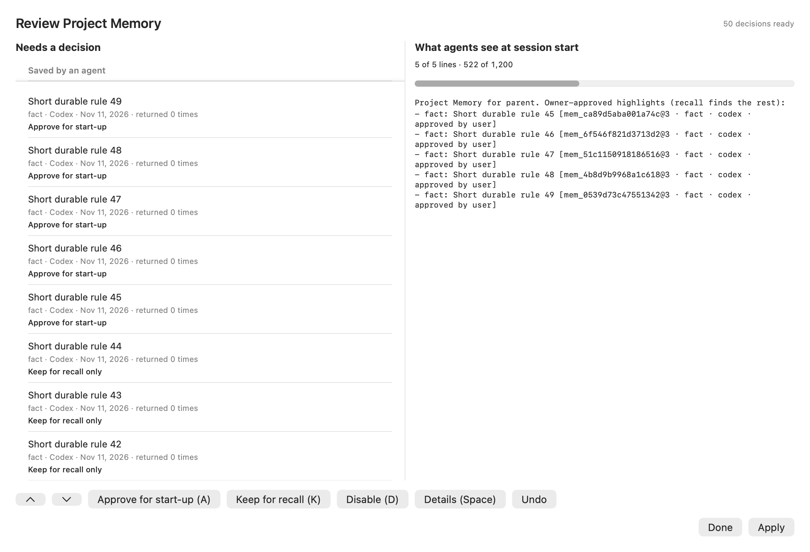

# Share Gantry with another agent user

[Repository](https://github.com/devin-lai/Gantry) · [Gantry 2.0.0](https://github.com/devin-lai/Gantry/releases/tag/v2.0.0) · [简体中文介绍](../README.zh-CN.md)

Share the official repository or release link so readers get the current
documentation, license, first-launch instructions, and checksum together.

## A short description

> Pick up where your last agent left off. Gantry is a native Mac workspace for Claude Code, Codex, Cursor, and more. Find past sessions, see what changed, and bring selected project decisions across Claude Code and Codex. Free for personal and commercial use. macOS 14.5+.

## A little more context

> Gantry 2.0 adds opt-in Project Memory for Claude Code and Codex. Save a decision once, review what can appear at startup, and find it again when you switch agents. Gantry also brings session history, cached quota, and MCP diagnostics into one Mac app. No Gantry account or analytics telemetry. Apple silicon and Intel, macOS 14.5+. This release uses ad-hoc signing and ships without Apple notarization. Follow the official first-launch guide.

## 简短介绍

> 换个编程助手，也能接着上次的工作。Gantry 2.0 为 Claude Code 和 Codex 提供可选的项目记忆。找回过去的对话与文件改动，并让下一次会话查到你保留的项目决策。个人与商业用途均免费，要求 macOS 14.5 或更新版本。当前版本未经 Apple 公证，请先阅读安装说明。

## What to keep clear

- Gantry is an independent companion app; tool coverage varies. Quota coverage is for Claude Code and Codex. Cursor includes desktop history and search, with usage, cost, and quota unavailable.
- Costs are estimates at API rates, and quotas are locally cached readings. Avoid presenting them as billing data or promising savings.
- Changed files come from recorded edit tools; Git checks do not establish who owns a change. Handoff notes contain recorded content, not a newly generated model summary.
- Gantry is completely free, including for commercial use. No separate permission is needed for business, employer, or client use.
- Link to the official download rather than rehosting the DMG. The [license](../LICENSE) does not grant a general reuse license for branding, artwork, or documentation.
- Use synthetic examples when discussing a workflow. Never share private session content, credentials, account identifiers, or unredacted diagnostics.

The 1.3.2 preview [Overview](../assets/overview-1.3.2-light.png), along with
the earlier 1.3.0 [Sessions](../assets/sessions-1.3.0-light.png) and
[Doctor](../assets/doctor-1.3.0-light.png) screenshots, illustrates the interface
with synthetic data. They are not customer records or performance benchmarks.
